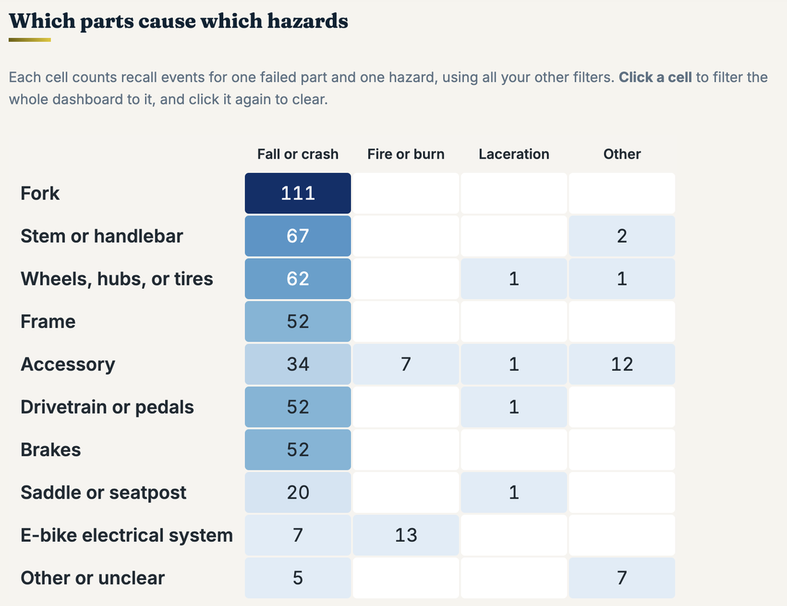

# Bike recall surveillance: bicycle, e-bike, and component recalls in the US and Canada

Every bicycle, e-bike, and bicycle component recall published by the US Consumer Product Safety Commission and Health Canada, sorted with a written case definition, classified by the part that failed and the hazard it caused, checked against hand-labelled records, and analysed with public health surveillance methods.

**Live site:** [emmabranch.github.io/bike-recall-surveillance](https://emmabranch.github.io/bike-recall-surveillance/) | **Code:** this repository | **More projects:** [github.com/emmabranch](https://github.com/emmabranch)

## What it does

- Downloads every US CPSC recall (Recalls API) and every Health Canada consumer product recall (open data), and reads each Health Canada recall page for its date, description, and hazard, because the open data file has neither.
- Applies a written **case definition**, like one used in disease surveillance, to select bicycle, e-bike, component, and accessory recalls, with confirmed and probable levels and a recorded reason for every decision.
- **Links joint recalls** announced in both countries (exact web address, then date and name similarity, then manual review), so each recall counts once.
- **Classifies** each recall by what was recalled, the part that failed, and the hazard, using transparent rules kept in CSV files, and extracts incidents, injuries, units, and country of manufacture from the text.
- **Validates** the rules against 100 hand-labelled records (development) and 40 held-back records (holdout), reporting accuracy, Cohen's kappa, PPV, NPV, and weighted sensitivity and specificity with bootstrap intervals.
- **Detects signals** with a historical limits approach: each year's count against a Poisson threshold from the previous five years, with year-to-date comparison for the current year.
- Presents it all as a seven-page Quarto website: overview, trends, e-bikes, signals, an interactive dashboard (Observable JS, no server), caveats, and methods.
- Publishes a documented dataset (CSV and Parquet) with a data dictionary.

The analysis is industry-wide. It does not rank or compare companies. Brand names appear only as published in the official notices.

## Data and licences

- **US recalls:** US Consumer Product Safety Commission, [Recalls API](https://www.cpsc.gov/Recalls/CPSC-Recalls-Application-Program-Interface-API-Information). US government work, public domain. Accessed November 2026.
- **Canadian recalls:** Health Canada, [Recalls and Safety Alerts](https://open.canada.ca/data/en/dataset/d38de914-c94c-429b-8ab1-8776c31643e3) open data and individual recall pages on recalls-rappels.canada.ca. Contains information licensed under the Open Government Licence – Canada. Accessed November 2026.
- **Code:** MIT licence (see [`LICENSE`](LICENSE)). Data keep their original licences, listed above.

This is an independent project using public data. It is not affiliated with or endorsed by CPSC, Health Canada, or any company named in the records.

## How to reproduce

1. Install R (4.3 or later), Quarto, and these packages: `httr2`, `jsonlite`, `dplyr`, `readr`, `stringr`, `purrr`, `tibble`, `tidyr`, `rvest`, `here`, `scales`, `openxlsx`, `readxl`, `arrow`, `knitr`.
2. Run the scripts in the `R/` folder, in this order:
   - `01_explore_sources.R` downloads the CPSC and Health Canada data into `data-raw/`
   - `02_profile_candidates.R` profiles the candidate records
   - `03_fetch_hc_pages.R` fetches each Health Canada recall page (about 10 minutes; pages are cached)
   - `04_parse_hc_pages.R` reads dates, descriptions, and hazards from those pages
   - `05_apply_case_definition.R` applies the case definition and links joint recalls
   - `06_classify_cases.R` classifies each case and writes `data/bike_recalls.csv`
   - `07_make_validation_sample.R` and `09_make_holdout_sample.R` draw the validation samples (they will not overwrite existing workbooks)
   - `08_score_validation.R` and `11_score_holdout.R` score the hand labels against the rules
   - `10_data_dictionary.R` writes the data dictionary and Parquet file
3. Run `quarto render`. The site is written to `docs/`.

Manual decisions are in `methods/manual_overrides.csv`, `methods/manual_links.csv`, `validation/adjudication.csv`, and `validation/holdout_adjudication.csv`, each with a written reason. The case definition is in `methods/case-definition.md`.

## Limitations

- Recalls are regulatory actions, not injuries, and there are no sales or exposure data, so counts cannot be read as risk.
- Recalls are mostly voluntary and negotiated, so counts reflect company reporting and regulator priorities as well as product safety.
- Canadian records start in 2008, are far fewer, and come from a different reporting system. Some joint recalls could not be linked and may be counted twice.
- Canada repealed its federal power-assisted bicycle definition in 2021, which may affect how e-bike problems reach Health Canada.
- The classification rules agree with hand labels most of the time, but not always: on the holdout sample, 82% for the failed part and 94% for the hazard. Older US records often have almost no hazard text.
- Recall notices rarely state top speed or motor power, so e-bikes cannot be reliably separated from faster electric motorbikes sold as e-bikes.
- Validation labels were made by the author, who also wrote the rules. An independent expert review is planned.

## About me

I'm Emma Branch, an epidemiologist and data analyst in British Columbia, and a PhD candidate in Population and Public Health at the University of British Columbia. I've spent about 10 years working with health research data, including registry analytics, REDCap database design, data governance, and performance measurement. I mostly work in R, SAS, and SQL, and build reports and tools with Quarto, Shiny, leaflet, and Power BI. Lately I've been applying the same habits to environmental and ocean data, mostly because I like maps and fish.
